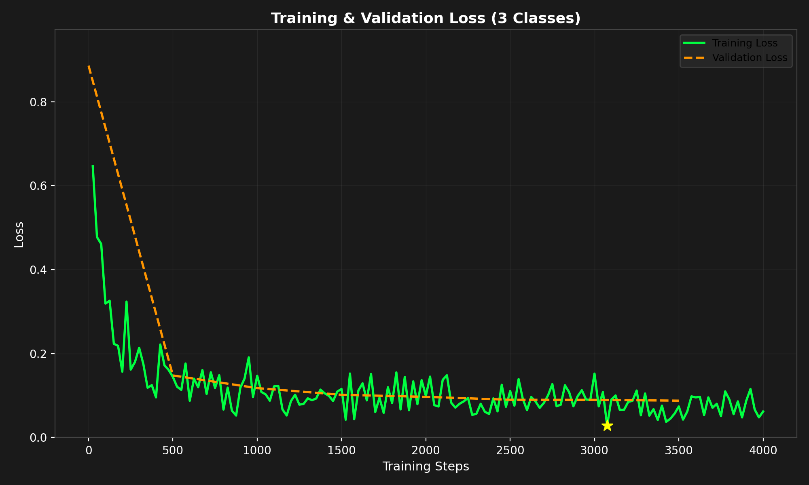

# Vision: Limelight Neural Detector

This is the object detection model that runs on the Limelight. It finds game samples by color.
The model runs **on the Limelight itself**. It is uploaded through the Limelight web UI and is
**not** bundled into the robot app (TeamCode). The robot code only reads detection results
through the Limelight API.

## Folder layout

```
vision/
├── README.md
├── models/
│   ├── limelight_neural_detector_coral.tflite   ← use this one if the Limelight has a Google Coral
│   ├── limelight_neural_detector_8bit.tflite    ← INT8 CPU model (no Coral)
│   ├── limelight_neural_detector_labels.txt     ← class labels, one per line
│   ├── training_log.txt                         ← full log from the training job
│   └── training_loss_graph.png                  ← train/validation loss curves
└── dataset/
    ├── README.dataset.txt / README.roboflow.txt ← Roboflow export info
    ├── train/  FTC-BioBuzz_label_map.pbtxt  (+ FTC-BioBuzz.tfrecord, not in git)
    ├── valid/  FTC-BioBuzz_label_map.pbtxt  (+ FTC-BioBuzz.tfrecord, not in git)
    └── test/   FTC-BioBuzz_label_map.pbtxt  (+ FTC-BioBuzz.tfrecord, not in git)
```

## Model

| | |
|---|---|
| Training job ID | `f5cbe6fa` (Limelight Model Trainer) |
| Trained | September 18, 2026 |
| Classes | `blue`, `red`, `yellow` (3) |
| Training | 4000 steps, batch size 16, 1× NVIDIA H100, target platform: Coral |
| Final loss | train 0.0617, validation 0.0875 |
| Outputs | up to 10 detections per frame (boxes, classes, scores) |

| File | Size | Use when |
|---|---|---|
| `limelight_neural_detector_coral.tflite` | 5.28 MB | The Limelight has a Google Coral accelerator (compiled for EdgeTPU) |
| `limelight_neural_detector_8bit.tflite` | 4.99 MB | No Coral; runs INT8-quantized on the Limelight CPU |

Class order matters. The detector's class IDs line up with the lines in
`limelight_neural_detector_labels.txt`:

| Class ID | Label |
|---|---|
| 0 | blue |
| 1 | red |
| 2 | yellow |

(The TFRecord label map counts from 1, so it lists blue=1, red=2, yellow=3. The Limelight
results count from 0.)



## Deploying to the Limelight

1. Connect to the robot and open the Limelight web UI at `http://limelight.local:5801`.
2. Pick a pipeline slot and set its type to **Neural Detector**.
3. Upload the model `.tflite` (Coral or 8-bit, see the table above) and
   `limelight_neural_detector_labels.txt` as the labels file.
4. Tune the confidence threshold, then save the pipeline.
5. In robot code, switch to that pipeline slot (`limelight.pipelineSwitch(<slot>)`) and read the
   detections from `LLResult.getDetectorResults()`.

Write down which pipeline slot holds this model here: **Slot: _TBD_**

## Dataset

- **Source:** Roboflow, [FTC-BioBuzz (ftc-biobuzz-6vjbl-p0any)](https://universe.roboflow.com/simra-ali/ftc-biobuzz-6vjbl-p0any)
- **Exported:** September 18, 2026, in TensorFlow TFRecord format
- **Size:** 19,268 images, no preprocessing or augmentation
- **License:** MIT

| Split | TFRecord size |
|---|---|
| train | 2.73 GB |
| valid | 83 MB |
| test | 41 MB |

The `.tfrecord` files are **ignored by git** (see `vision/.gitignore`). `train` is 2.7 GB, which is
over GitHub's per-file limit, even with Git LFS. Only the label maps and dataset READMEs are
committed. To get the full data, export the dataset from Roboflow again
(*Download Dataset → TFRecord*) and unzip it into `vision/dataset/`.

## Retraining

1. Add or relabel images in the Roboflow project, then make a new dataset version.
2. Export it as **TensorFlow TFRecord** and run the Limelight Model Trainer on the export.
3. Replace the files in `models/` with the new output, then update the **Model** table above
   (job ID, date, losses) and the dataset section.
